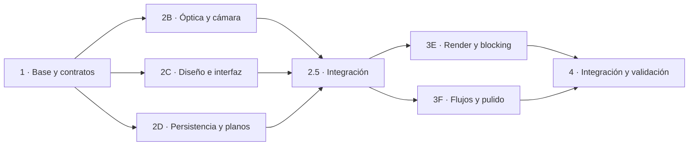

# Plan de mejora de CineOptics

Fecha: 2026-10-13. Estado: **E/F integrado; smoke focalizado de navegador y datos aprobado; matriz amplia y rendimiento de runtime pendientes**.

## Decisión principal

Primero corregir coherencia técnica y separar responsabilidades; después completar interacción, persistencia y pulido. Cambiar colores sobre el monolito no resolvería los problemas de cámara ni permitiría un trabajo paralelo cómodo.

La versión objetivo mantiene el carácter de herramienta profesional, con información técnica accesible y menos ruido visual. El usuario principal sabe qué son focal, foco, sensor y blocking: la interfaz debe facilitar decisiones, sin llenar el visor de explicaciones permanentes.

## Alcance de la versión 1

1. Escena con hasta seis actores, selección, posición, orientación y poses coherentes.
2. Cámara única con sensor/gate, focal, apertura f, foco, orientación y movimiento evaluados consistentemente.
3. Visor y tres vistas técnicas que describen la misma escena. Planta editable con ratón, táctil y campos numéricos.
4. Presets referidos al actor seleccionado, encuadre estable al redimensionar y aviso cuando el bloqueo de encuadre alcanza sus límites.
5. Captura reproducible del encuadre, notas, ordenar/duplicar/eliminar planos, guardar/abrir proyecto y exportar CSV e imagen.
6. UI adaptable a escritorio y tablet, teclado, estados vacíos, errores y recuperación local.
7. Efectos visuales identificados como aproximaciones. Obturación como metadato con tiempo de exposición calculado; simulación real de motion blur fuera de esta versión.

Fuera del primer cierre: fotorealismo, importación de modelos 3D, colaboración en red, backend, cuentas, calibración comercial de lentes, motor de iluminación física, timeline completo y exportación de video. No hacen falta para resolver los fallos actuales.

## Hallazgos que gobiernan el orden

| Prioridad | Problema | Consecuencia |
|---|---|---|
| P1 | Órbita y proyección incoherentes; FOV ligado al tamaño del canvas | El encuadre puede ser incorrecto aunque los números parezcan correctos |
| P1 | Distancia de foco distinta de la profundidad usada para desenfoque | Enfocar un actor no asegura consistencia con su imagen |
| P1 | Restauración parcial de controles, foco por índice, reset incompleto | Estado visible y proyecto divergen |
| P1 | Planilla solo en memoria | Se pierde trabajo al recargar |
| P1 | Nombres insertados como HTML | Entrada de usuario interpretada como marcado |
| P2 | ND/grano/obturación sin efecto visual; radar promete mover sin implementarlo | Controles engañosos y frustración |
| P2 | Sin adaptación de layout y semántica incompleta | Uso difícil con paneles estrechos, teclado o tablet |
| P2 | Render continuo y reconstrucción de listas por frame en animaciones | Trabajo innecesario; impacto de rendimiento por medir |

La [auditoría](docs/AUDITORIA.md) aporta evidencia y separa hechos de hipótesis.

## Fases y cantidad de agentes

Se recomiendan **cuatro chats reutilizables**, con un máximo habitual de **tres implementadores simultáneos**. Son roles de agentes; no se necesitan cuatro personas. Un chat integra y mantiene contratos. Durante la fase paralela puede quedar en espera.

| Fase | Trabajo | Chats trabajando a la vez | Dependencia | Puerta de salida |
|---|---|---:|---|---|
| 0 — Revisión | Auditoría, plan, documentación y diagnóstico | 1 | Ninguna | Entregado en esta carpeta; QA visual pendiente declarada |
| 1 — Base | A: estructura modular, estado, tipos, entradas y adaptadores del legado | 1 | Fase 0 | **Entregada en `docs/handoffs/A.md`**; puerta técnica aprobada, HTTP/navegador pendiente |
| 2 — Fundamentos en paralelo | B: óptica/cámara; C: interfaz; D: persistencia/planilla | 3 | Fase 1 integrada | Entregas compartidas B/C/D revisadas; sin commits por rol |
| 2.5 — Integración | A integra B/C/D y resuelve incompatibilidades | 1 | Las tres entregas | **Código integrado; tipos/tests/build verificados.** Aceptación visual e IndexedDB de navegador pendiente |
| 3 — Funcionalidad y pulido | E: render/mapas/interacción; F: flujos de UI y planilla | 2 | Fase 2.5 | **Integración E/F y G-001–G-004 implementada; smoke QA de gestos, reproducción, proyecto y guardado en Chrome.** V12–V20 completos siguen abiertos |
| 4 — Cierre | A integra/corrige; G revisa, mide y registra defectos | Hasta 2, con propiedad separada | Fase 3 | Matriz de aceptación, capturas y mediciones; ningún P1 abierto |

### Fase 1: habilitar el trabajo paralelo — entregada

La base incluye `index.html`, TypeScript y Vite, tipos, acciones, store, datos, fixtures y navegación inicial de cuatro vistas. El renderer y los controles migrados son parciales y aproximados; los hallazgos de la auditoría continúan abiertos salvo comportamiento implementado de manera explícita. El HTML de referencia conserva su hash original. El handoff registra pruebas y limitaciones.

Antes de B/C/D: existen IDs estables, distinción entre proyecto/UI/runtime, contrato de cámara evaluada, esquema de snapshots y APIs de render/captura/persistencia. Los adaptadores provisionales dejan la base compilable, sin declarar corregidas las matemáticas, la fidelidad visual ni la persistencia.

### Fase 2.5: integración — código conectado

B → D → C se integraron en la carpeta compartida; los tres handoffs se revisaron y no hay commits/worktrees individuales que cherry-pickear. `deriveFrame` conecta cámara/óptica, la entrada conecta captura/snapshots/repositorio, y C aporta `mountWorkspace`. Contratos y tipos de snapshot están formalizados en `src/contracts`. Los checks automáticos finales se registran en `docs/handoffs/A.md`; la falta de navegador mantiene pendientes los criterios visuales y la validación real de IndexedDB. E/F quedan habilitados con las APIs publicadas en ese handoff.

### Integración E/F y respuesta a G

E/F están presentes en el checkout compartido y conectados en la entrada: `FrameModel` incluye `look`, gestos reciben viewport CSS, scheduler impulsa invalidaciones y playback, UI edita posiciones X/Y/Z, configura movimiento básico, crea proyectos nuevos y solicita guardado manual a la misma cola del autosave. G-001–G-004 están corregidos. La revisión posterior comprobó Órbita, Handheld, edición literal y round-trip local de dos planos en Chrome; sigue pendiente una parte sustancial de la matriz visual y de runtime. El import dinámico de Three.js redujo el bundle de entrada de 630,94 kB a 76,80 kB, pero solicita el chunk 3D durante inicialización; este conserva 555,62 kB y la advertencia de Vite. Rack focus se aplaza como P2, con contrato/curvas/persistencia como trabajo futuro. Evidencia y límites en [handoff A](docs/handoffs/A.md).

### Fase 2: tres encargos independientes

- **B — Matemática:** transformaciones de cámara, gate/aspecto/FOV, foco/DoF, compensación de encuadre y presets. Entrega funciones puras, ejemplos numéricos y tests independientes del DOM.
- **C — Interfaz:** composición visual, controles etiquetados, navegación por teclado, responsive y estados derivados del store. Trabaja con fixtures de los contratos, sin inventar fórmulas.
- **D — Datos:** snapshots versionados, almacenamiento recuperable, validación de importación, catálogo de planos y exportación CSV. No construye la UI ni genera miniaturas desde el DOM.

### Fase 3: conectar la experiencia

- **E — Render e interacción:** todas las vistas consumen la cámara de B; planta editable; selección correcta con roll; render bajo demanda; cámara de captura independiente de la vista activa. ND como atenuación relativa aproximada y grano reproducible, con etiquetas honestas.
- **F — Flujos:** conecta planilla, guardar/abrir, notas y estado de guardado; simplifica terminología, controles y ayuda contextual; completa accesibilidad. Consume servicios y renderer, sin modificar sus implementaciones.

E y F acuerdan su API al terminar 2.5. Si necesitan cambiarla, A actualiza el contrato y ambos se sincronizan antes de integrar.

### Fase 4: comprobar que realmente está listo

G escribe casos de navegador y un informe de hallazgos; A integra y asigna las correcciones al dueño correspondiente. Evitar que revisor e implementador editen el mismo archivo. Validar principalmente encuadre invariante, fidelidad de snapshots, pérdida de foco al borrar, guardado y claridad de UI. Rendimiento se mide contra un baseline real del mismo equipo, nunca se presume.

## Cómo lanzarlos

1. Abrir un chat del proyecto con el prompt A de [PROMPTS_CHATS.md](docs/PROMPTS_CHATS.md).
2. Esperar su entrega y la puerta de fase 1. Si no hay separación funcional, continuar A; no abrir B/C/D todavía.
3. Abrir tres chats del mismo proyecto con B, C y D. Elegir GPT-6 Luna y pensamiento Alto en cada uno.
4. Al terminar, volver a A con las tres entregas y pedir integración 2.5.
5. Reutilizar B para E y C para F, tras actualizar ambos al estado integrado. D puede esperar.
6. A integra la fase 3. Reutilizar D como G para revisión con contexto actualizado, o abrir un chat nuevo si se desea una revisión más independiente.

**Si solo quieres un chat:** A → B → D → C → integración → E → F → G. Si usas dos implementadores, B y C primero; D cuando termine uno. Lo importante es respetar dependencias, no alcanzar una cantidad fija de agentes.

## Cómo evitar conflictos

La carpeta revisada no contiene `.git`. Un proyecto de Codex por sí solo no implica aislamiento del código. Para trabajo paralelo se recomienda que A prepare Git local y un baseline antes de crear ramas/worktrees; comprobar primero que no haya un repositorio padre y no sobrescribir configuración existente. Cada trabajador parte del mismo commit de fase 1, con un worktree propio. A integra commits concretos en orden B → D → C y vuelve a ejecutar los checks.

Si se mantiene una sola carpeta compartida, usar la propiedad de archivos de [ARQUITECTURA.md](docs/ARQUITECTURA.md). Ningún trabajador toca configuración ni contratos; no correr formateos globales; integrar solo cuando terminen los tres. Para roles que deban tocar los mismos archivos, ejecutar secuencialmente. OneDrive no sustituye control de versiones y no debe resolver conflictos de código entre equipos.

## Modelo y nivel de razonamiento

**GPT-6 Luna + Alto es la configuración recomendada para estos encargos acotados.** La documentación oficial propone Luna para tareas delimitadas y `high` como punto de partida explícito. La separación en módulos y los criterios de aceptación son lo que hacen razonable usarlo para la mayor parte del código. [Guía oficial de subagentes](https://learn.chatgpt.com/docs/agent-configuration/subagents).

Para A, B y una revisión final compleja, mantener Luna Alto inicialmente. Si aparecen errores reiterados de geometría, decisiones ambiguas o integración, pedir una revisión puntual con GPT-6.1 Sol Alto, si está disponible, en vez de subir el esfuerzo de todos los chats. Esta es una recomendación de trabajo, no una garantía de velocidad o calidad.

No se estiman créditos ni se equipara precio de API con consumo de la suscripción. No se han creado chats ni cambiado modelos en esta revisión. La disponibilidad real y los niveles se comprueban en el selector del cliente. [Ficha oficial de GPT-6 Luna](https://developers.openai.com/api/docs/models/gpt-6-luna).

## Control de alcance y cierre

Cada encargo debe terminar con una entrega pequeña y verificable, no con una reescritura total. Si un módulo crece demasiado, partir por criterios funcionales: por ejemplo, geometría primero y DoF después; almacenamiento primero y exportación después.

La versión se cierra cuando todos los P1 están resueltos, los P2 incluidos tienen aceptación verificada y los aplazados aparecen como limitaciones visibles. La implementación de motor 3D real se evalúa después, solamente si las necesidades de oclusión, geometría y luz superan lo que puede representar el renderer actual.
